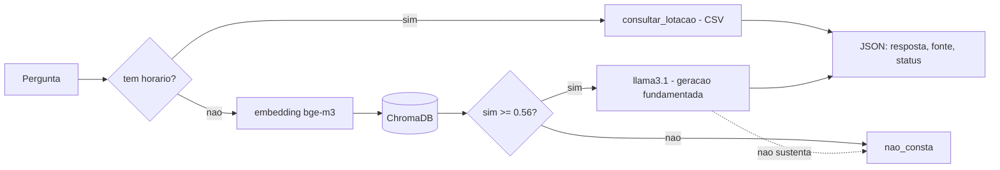

# ForaDoPico — Assistente de Lotação (Generative AI for Engineering)

Componente de **Inteligência** do MVP ForaDoPico (GS FIAP 2026.2 — CitizenTech).
Assistente local (LLM + RAG + ferramenta) que responde sobre **lotação prevista e
melhor horário** das Linhas 1-Azul e 3-Vermelha do Metrô-SP, citando a fonte e
recusando o que está fora da cobertura. Os dados vêm da view `vw_app_lotacao_prevista`
(camada Ouro) — a mesma tabela que o app usa.

## Integrantes
- Victor Wittner — 98667
- Matheus Haruo — 97663
- João Saborido — 98184
- Pedro Guerra de Souza Freitas — 99526

## Ficha Técnica (resumo)
| Campo | Valor |
|---|---|
| Produto | ForaDoPico — "Pergunte ao ForaDoPico" (lotação) |
| Cidadão / território | Passageiro das Linhas 1 e 3 do Metrô-SP |
| Problema (1 frase) | O passageiro não sabe qual o melhor horário para evitar a lotação |
| Proposta de valor | Diz o pico, o melhor horário e o número exato por faixa, com fonte, recusando o que não cobre |
| Modelos de IA | `llama3.1:8b` (geração) · `bge-m3` (embeddings) — locais via Ollama |
| Ferramenta | `consultar_lotacao(estacao, dia, horario)` — número exato do CSV |
| Fonte de dados | `vw_app_lotacao_prevista` (Ouro) — Metrô jan–set/2026 |
| LGPD | dado agregado por estação, sem dado pessoal |
| ODS | 11 · 9 · 3 · 10 |

## Arquitetura do pipeline


## Estrutura do repositório
```
.
├── base/
│   ├── dados/vw_app_lotacao_prevista.csv   # fonte (camada Ouro)
│   ├── base_conhecimento.json              # 289 trechos gerados do CSV
│   ├── escopo.md
│   └── README.md
├── avaliacao/
│   ├── testset.json                        # 29 perguntas (gabarito do CSV)
│   ├── avaliar_retrieval.py                # recall@1/@3 + limiar
│   ├── comparar_configs.py                 # placar das 3 configs
│   ├── erros.md                            # 5 erros reais (item 07)
│   ├── placar.json / placar.png
├── api/                                    # API FastAPI (contrato do app)
├── notebooks/                              # (notebook com saidas - a adicionar)
├── construir_base.py                       # CSV  -> base_conhecimento.json
├── construir_testset.py                    # CSV  -> testset.json
├── ingest.py                               # base -> ChromaDB
├── ferramentas.py                          # consultar_lotacao
├── rag.py                                  # RAG simples (JSON + recusa)
├── agente.py                               # agente com ferramenta
├── perguntar_cli.py                        # pergunta/resposta pelo terminal
├── requirements.txt
└── relatorio.md
```

## Como reproduzir
Pré-requisito: [Ollama](https://ollama.com) instalado e aberto.

```bash
# 1. Modelos
ollama pull llama3.1:8b
ollama pull bge-m3

# 2. Ambiente (Python 3.11)
python -m venv .venv
source .venv/Scripts/activate      # Windows Git Bash
pip install -r requirements.txt

# 3. Gerar base e testset a partir do CSV
python construir_base.py base/dados/vw_app_lotacao_prevista.csv
python construir_testset.py

# 4. Indexar e avaliar
python ingest.py
python avaliacao/avaliar_retrieval.py
python -m avaliacao.comparar_configs

# 5. Usar
python perguntar_cli.py "Quantas pessoas entram na Se na segunda as 18h?"
uvicorn api.main:app --reload     # http://127.0.0.1:8000/docs
```

## Resultados
- Recuperação: **recall@1 = 100%**, **recall@3 = 100%** (24 perguntas de escopo).
- Placar das 3 configurações (acurácia): sem contexto **7%** · RAG simples **72%** · agente **97%**.
- Número exato por faixa: RAG simples **0%** → agente **88%** (vantagem da ferramenta).
- Alucinação nas perguntas fora de escopo: RAG e agente recusam **100%**.

Detalhes em `relatorio.md`.