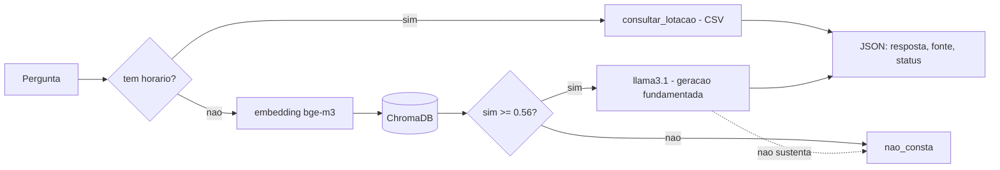

# Relatório — Generative AI for Engineering
## ForaDoPico · "Pergunte ao ForaDoPico" (lotação) · GS FIAP 2026.2 (CitizenTech)

### 1. Integrantes
- Victor Wittner — 98667
- Matheus Haruo — 97663
- João Saborido — 98184
- Pedro Guerra de Souza Freitas — 99526

### 2. Ficha Técnica
- **Nome do produto:** ForaDoPico — assistente "Pergunte ao ForaDoPico" (lotação).
- **Cidadão e território:** passageiro das Linhas 1-Azul e 3-Vermelha do Metrô de São Paulo.
- **Problema (em uma frase):** o passageiro não sabe qual o melhor horário para evitar a lotação da sua estação.
- **Proposta de valor:** o assistente informa o pico, o melhor horário e o número exato de entradas por faixa de 15 min, sempre citando a fonte e recusando o que está fora da cobertura.
- **Arquitetura:** embeddings `bge-m3` → ChromaDB → geração com `llama3.1:8b`, mais a ferramenta `consultar_lotacao` para números exatos; exposto por API FastAPI.
- **Fonte de dados:** view `vw_app_lotacao_prevista` (camada Ouro do Databricks), derivada do total diário de entradas por estação publicado pelo Metrô (jan–set/2026).
- **Modelos de IA:** `llama3.1:8b` e `bge-m3`, locais via Ollama.
- **URL do MVP e repositório:** _preencher com os links públicos._
- **Indicadores de impacto:** acurácia do assistente e taxa de recusa correta (seção 5).
- **LGPD:** dado agregado por estação, sem dado pessoal.
- **ODS conectados:** 11 (cidades sustentáveis), 9 (infraestrutura/inovação), 3 (saúde e bem-estar), 10 (redução das desigualdades).

### 3. Diagrama do pipeline

Duas camadas de recusa (limiar + geração fundamentada) e um atalho determinístico:
quando a pergunta cita um horário, a ferramenta responde o número exato do CSV.

### 4. Base de conhecimento
Gerada automaticamente do CSV pelo `construir_base.py`.

| Atributo | Valor |
|---|---|
| Nº de trechos | 289 (287 estação×dia + metodologia + cobertura) |
| Formato | JSON (um objeto por trecho) |
| Fonte | `vw_app_lotacao_prevista - Ouro ForaDoPico - Metro jan-set/2026` |
| Licença | dado agregado por estação, sem dado pessoal (LGPD ok) |
| Cobertura | Linhas 1-Azul e 3-Vermelha; faixas de 15 min |

**Metodologia (disclosure obrigatório):** a lotação por faixa é **estimada**. O Metrô
publica só o total diário por estação; a distribuição por horário vem de um perfil
típico (picos às 07:00 e 18:00). O assistente informa isso quando a pergunta envolve precisão.

### 5. Performance
**Recuperação** (`avaliar_retrieval.py`, 24 perguntas de escopo):
- recall@1 = **100%**, recall@3 = **100%**.
- Limiar de similaridade = **0,56**, dentro do intervalo observado (escopo mín. 0,618;
  fora de escopo máx. 0,531 — sem sobreposição).

**Placar das 3 configurações** (`comparar_configs.py`), ver `placar.png`:

| Configuração | Resposta correta | Número exato | Recusa correta | Acurácia |
|---|---|---|---|---|
| Sem contexto (baseline) | 0% | 0% | 40% | **7%** |
| RAG simples | 67% | 0% | 100% | **72%** |
| Agente (com ferramenta) | 96% | 88% | 100% | **97%** |

**Interpretação:** sem contexto o modelo alucina (acurácia 7%). O RAG dá o salto para
72% e zera a alucinação nas recusas. O agente chega a 97% e, principalmente, resolve as
perguntas de **número exato** (0% → 88%), que o RAG semântico não consegue — comprovando
que a IA acerta mais e alucina menos que o mesmo modelo sem contexto.

### 6. Cinco erros reais e correções
Detalhados em `avaliacao/erros.md`. Resumo:
1. IDs duplicados da Sé (L1 x L3) → incluir a linha no id.
2. Agente roteando mal pico/melhor → só usar a ferramenta com horário explícito (69% → 97%).
3. RAG zera no número exato → ferramenta `consultar_lotacao`.
4. "Melhor horário" caindo de madrugada → restringir a janela útil.
5. Baseline sem contexto alucina → justifica o RAG (7% → 72% → 97%).

### 7. Conclusão
O componente de IA do ForaDoPico entrega um assistente local, de baixo custo e
reprodutível, que responde sobre lotação com fonte, número exato quando há horário, e
recusa com segurança o que está fora da cobertura. A avaliação mostra ganho claro do RAG
sobre o baseline e do agente sobre o RAG simples. A integração com o produto é feita pela
API `POST /perguntar`, que devolve `{resposta, fontes, recusou}` — o contrato consumido
pelo app, usando a mesma tabela Ouro.

**Link do repo não esquece anta:** 